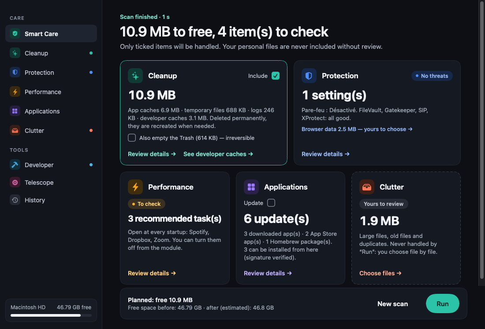

# CleanMac Pro

> A lean, fast, transparent disk cleaner for macOS — native Swift + SwiftUI.

[](https://swift.org)
[](#)
[](LICENSE)
[](#)

<p align="center">
  
</p>

## Why?

Mac cleaners are usually one of three things: bloated Electron apps, pushy
freemium upsell engines, or opaque tools that delete things you can't see.
**CleanMac Pro is none of those.**

- **Native** — Swift + SwiftUI, ~4 MB binary, runs cold in under a second.
- **Transparent** — every byte is shown with its path before anything moves; each row says what will happen to it.
- **Safe by policy** — regenerable data (caches, logs, temp files, developer caches) is deleted for good, so the space is freed immediately; personal files (large / old files, duplicates, photos) and browser data go to the Trash and can be restored from History. "Smart Care" never touches personal files you did not review.
- **Honest numbers** — the Result screen shows the free space of the volume measured before and after, not just the sum of file sizes.
- **Local** — zero network calls outside the optional iTunes Search lookup for App Store updates.
- **No marketing modals.** Ever.

## Features

| Module          | What it does                                                              |
|-----------------|---------------------------------------------------------------------------|
| **Smart Care**  | One analysis (cleanup, developer caches, clutter, browsers, security, performance, updates) → result cards (Nettoyage · Protection · Performances · Applications · Encombrement), each with a tick, a summary and "Revoir" → one big **Lancer** that runs only what is safe and ticked → measured result |
| **Cleanup**     | Caches (one row per app, real icon), temp files, logs, system caches, Trash — deleted permanently (`~/Library/Caches`, `~/Library/Logs`, …) |
| **Uninstaller** | Apps + residues across `~/Library/Application Support`, Caches, Containers|
| **Files**       | Large files (≥ 50 MB) + old files (> 180 d) + SHA-256-verified duplicates |
| **Similar photos** | Files tab: perceptual dHash (64-bit, BK-tree) groups near-identical photos, keeps the best, trashes the rest |
| **Developer**   | Xcode DerivedData / old Archives / DeviceSupport / simulators, SwiftPM · Gradle · npm · Yarn · pnpm · CocoaPods caches, stale `node_modules`, `brew cleanup`, `docker system prune` |
| **Space Lens**  | Squarified treemap of the home directory with drill-down                  |
| **Security**    | FileVault, Gatekeeper, SIP, Firewall, XProtect, known-malware paths       |
| **Privacy**     | Per-browser cookies / cache / history — Safari, Chrome, Firefox, Brave, Arc|
| **Updates**     | App Store via iTunes Search API · Homebrew formulae + casks · macOS softwareupdate|
| **Performance** | Login items, LaunchAgents, top RAM consumers — disable from the row        |
| **Maintenance** | 6 real macOS maintenance commands with native admin prompts                |
| **Result**      | Space really freed (volume free space before → after), permanent vs Trash breakdown, failures |
| **History**     | Every cleanup; "Restaurer" only for what went to the Trash                  |
| **Settings**     | Scheduled scans (LaunchAgent, daily/weekly + time) · exclusions (paths, apps; right-click "Ne plus proposer") · cleanup history with one-click restore from the Trash |

Plus: **menu bar panel** (live CPU/RAM/disk, run Smart Care, empty the Trash, scheduled scan), **onboarding** with explicit "what we touch / what we
don't" transparency screen.

## Architecture

```
Sources/
├── CleanCore/                # Library — pure, no UI deps
│   ├── Models.swift          # ScanItem, ScanResult, ModuleID, Severity
│   ├── Scanner.swift         # FileScanner protocol + Cleaner (policy-aware: permanent vs Trash)
│   ├── SmartCare.swift       # SmartCarePlan: default selection + what "Lancer" may run
│   ├── DiskSpace.swift       # free-space snapshots + SpaceMeasure (before / after)
│   ├── FileSystem.swift      # FS enumeration + ByteFormatter
│   ├── Shell.swift           # Run system CLIs with timeout
│   └── Scanners/
│       ├── CleanupScanner.swift       # caches/logs/temp/trash, one row per app folder
│       ├── LargeFilesScanner.swift
│       ├── DuplicatesScanner.swift    # size group + SHA-256
│       ├── AppUninstaller.swift
│       ├── SpaceLensScanner.swift     # du-based home survey
│       ├── SecurityScanner.swift      # fdesetup, spctl, csrutil, socketfilterfw, XProtect
│       ├── PrivacyScanner.swift       # per-browser data
│       ├── UpdatesScanner.swift       # iTunes Search API + brew + softwareupdate
│       ├── PerformanceScanner.swift   # osascript login items, LaunchAgents, ps
│       └── MaintenanceScanner.swift   # 6 real maintenance commands
│
├── CleanMacPro/              # Executable — SwiftUI app
│   ├── App.swift
│   ├── AppState.swift
│   ├── DashboardView.swift   # RootView, MainPane
│   ├── Theme/Tokens.swift    # design system: palette (canvas, card, border, text), category accents,
│   │                         # spacing / radius scale, card surface
│   ├── Components/           # Btn (pill), CmpCheckbox, IconChip, HeroRing, EmptyState, Banner,
│   │                         # real app / file icons (AppIdentity), SortMenu, ScreenHeader, …
│   ├── Shell/                # Sidebar (IconRail), MenuBarPanel, Onboarding, Settings, UITestDriver
│   └── Screens/              # SmartScan (home → results cards → run), ReviewScreen (two-pane review),
│                             # ScanScreen (generic), Result, History, SpaceLens
│
└── CleanMacProSmoke/         # Standalone runner — exercises scanners with no XCTest
```

A single `FileScanner` protocol drives every module:

```swift
public protocol FileScanner: Sendable {
    var module: ModuleID { get }
    func scan(progress: @escaping (Double, String) -> Void) async throws -> ScanResult
}
```

The UI treats every scanner the same way: empty → scanning → results, with sort/select/clean.

## Install

macOS 14+ on Apple Silicon. One command installs (or updates) the latest release into `/Applications`:

```bash
curl -fsSL https://vantaflow.github.io/cleanmac-pro/install.sh | bash
```

Downloaded with `curl`, the app carries no quarantine flag, so Gatekeeper doesn't block it even though it isn't notarized.
If you downloaded the zip from the browser instead: `xattr -dr com.apple.quarantine "/Applications/CleanMac Pro.app"`
(or System Settings → Privacy & Security → *Open Anyway*).

## Build

Requires Swift 5.9+ (Xcode 15 or macOS Command Line Tools).

```bash
swift build -c release
./Tools/build-app.sh                 # assembles CleanMac Pro.app + ad-hoc signs
cp -R "build/CleanMac Pro.app" /Applications/
```

Or open the package in Xcode:

```bash
open Package.swift
```

## Verify

```bash
swift run CleanMacProSmoke   # 8 checks against fixture trees
```

The CI `ui` job launches the built `.app` with `--ui-test`: it skips onboarding, captures every screen to PNG + `report.json`, and drives Smart Care end to end on a throw-away fixture tree (analyse → review → tick → **Lancer** → checks on disk: caches gone for good, unreviewed personal files untouched, Trash move restorable). It only ever touches its own fixtures.

XCTest tests live in `Tests/CleanCoreTests/` — they run when you have a full
Xcode install (Command Line Tools alone can't import `XCTest`).

## Release & auto-update

CleanMac Pro updates itself through [Sparkle 2](https://sparkle-project.org)
(menu **Rechercher des mises à jour…**, feed `docs/appcast.xml` served by GitHub Pages).

- **One-time setup:** on a Mac, after `swift build`, run `./Tools/make-sparkle-keys.sh`
  (creates the EdDSA keys, writes the public key into `Tools/Info.plist`, stores the
  private key as the `SPARKLE_ED_PRIVATE_KEY` secret). Commit `Tools/Info.plist`.
  Until then the update menu item stays disabled.
- **Release:** push a tag `vX.Y.Z`. `.github/workflows/release.yml` builds, zips the `.app`,
  creates the GitHub release and adds the item to the appcast. Test with
  *Actions → Release → Run workflow* (`dry_run` = true: zip as artifact only).

## Permissions

Some modules need extra macOS permissions to be fully useful:

| Module       | Permission                              | Effect if missing                       |
|--------------|------------------------------------------|------------------------------------------|
| Cleanup      | (none)                                  | Skips unreadable system caches silently; root-owned ones ask for admin once |
| Files / Space Lens | **Files and Folders** or Full Disk Access | Some folders show as empty       |
| Privacy      | Full Disk Access                        | Safari history/cookies invisible         |
| Performance  | Automation (System Events)              | Login items list is empty                |
| Maintenance  | Native admin prompt at run time          | sudo tasks fail otherwise                |

## Roadmap

- [ ] Notarized signed distribution
- [x] Automated release workflow + Sparkle auto-update (run `Tools/make-sparkle-keys.sh` once)
- [x] Sparkle feed checks for direct-download apps, with in-place update (zip/dmg, codesign + EdDSA verified)
- [ ] Optional Claude API integration for the AI assistant overlay
- [x] Schedule scans via LaunchAgent
- [x] Locales: FR / EN / ES / DE

## Credits

- UI design ported from the prototype generated with [Claude Design](https://claude.ai/design).
- Built with [Claude Code](https://claude.com/claude-code) — most code in this
  repo was authored by Claude, reviewed and merged by a human.

## License

MIT — see [LICENSE](LICENSE).
